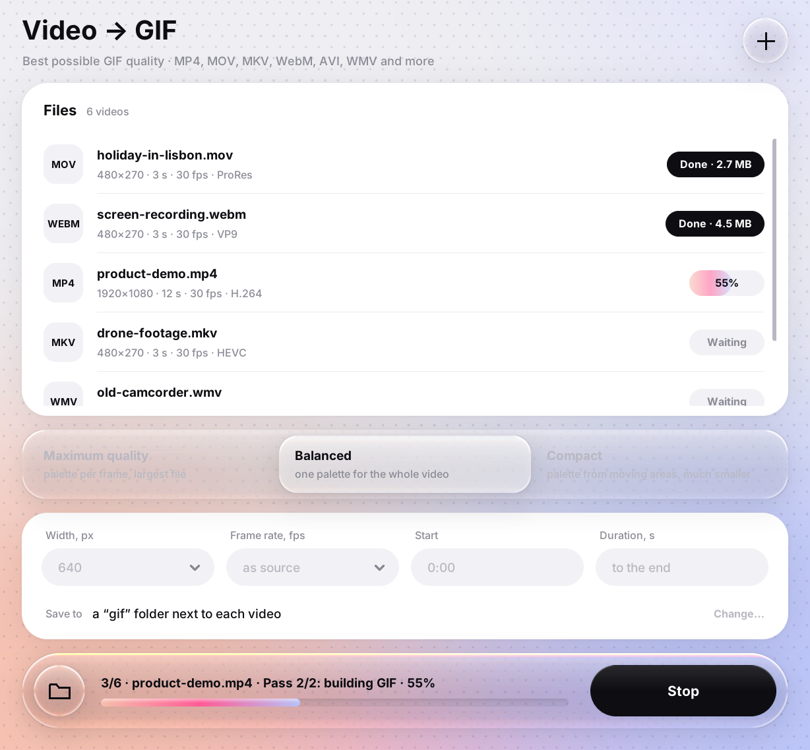

<p align="center">
  
</p>

<h1 align="center">GifConvert</h1>

<p align="center">
  Convert videos to GIF with the best quality the format allows.<br>
  Windows · macOS · Linux — ffmpeg is built in, nothing else to install.
</p>

<p align="center">
  <a href="https://github.com/teplarium/GifConvert/releases/latest"><b>Download</b></a>
  ·
  <a href="LICENSE">MIT License</a>
</p>



## Features

- **Any common video format:** MP4, MOV, MKV, WebM, AVI, WMV, FLV, MPG, TS/MTS/M2TS, 3GP, OGV, MXF, DV and
  animated GIF. Covered codecs include H.264, HEVC (also 10-bit), AV1, VP8/VP9, ProRes, MPEG-1/2/4, WMV, MJPEG and DV.
- **Three quality modes:**
  - **Maximum quality:** a separate 256-color palette for every frame.
  - **Balanced:** one optimized palette for the whole video.
  - **Compact:** a palette built from moving areas, giving much smaller files.
- **Size and length controls:** width, frame rate (GIF tops out at 50 fps), start time and duration.
- **Automatic fixes:** portrait phone videos are rotated, interlaced camcorder footage is deinterlaced, and
  non-square pixels (DV, DVD) are corrected.
- **Easy to use:** drag & drop files or whole folders, convert a batch with per-file progress, and cancel at any time.
  GIFs go to a `gif` folder next to each video, or to a folder you choose.
- **Command-line mode** for scripts.

## Download

Grab the file for your system from the [latest release](https://github.com/teplarium/GifConvert/releases/latest):

| System | File | Works on |
|---|---|---|
| Windows 64-bit | `GifConvert-windows-x64.exe` | Windows 10 / 11 |
| Windows 32-bit | `GifConvert-windows-x86.exe` | Windows 10 (32-bit) |
| Mac with Apple Silicon (M1 and newer) | `GifConvert-macos-arm64.zip` | macOS 11+ |
| Mac with Intel | `GifConvert-macos-intel.zip` | macOS 11+ |
| Linux x64 | `GifConvert-linux-x64.tar.gz` | Ubuntu 22.04+, Debian 12+, Mint 21+, Fedora 36+ and similar |

### Windows
Run the `.exe`. There is nothing to install, because the app is a single file. The first start takes a few seconds while the built-in
ffmpeg is unpacked.

The app is not signed with a paid certificate, so Windows SmartScreen may say *"Windows protected your PC"*.
Click **More info → Run anyway**. Some antivirus programs also flag unsigned apps packed with PyInstaller.
If that happens, build the app yourself (see below) or add an exception.

You can drop videos straight onto `GifConvert.exe` and the window opens with them.

### macOS
1. To check your chip, open  → **About This Mac**. **Apple M…** means you need `arm64`, **Intel** means you need `intel`.
2. Unzip the file and move **GifConvert.app** to **Applications**.
3. The app is not notarized by Apple, so the first launch is blocked. Click **Done**, open
   **System Settings → Privacy & Security**, scroll down and click **Open Anyway**, then confirm.
   You only need to do this once.

   Or use Terminal:
   ```bash
   xattr -dr com.apple.quarantine /Applications/GifConvert.app
   ```

### Linux
```bash
tar xzf GifConvert-linux-x64.tar.gz
./GifConvert
```
To add it to the app menu, create `~/.local/share/applications/gifconvert.desktop`:
```ini
[Desktop Entry]
Type=Application
Name=GifConvert
Exec=/full/path/to/GifConvert %F
Terminal=false
Categories=Graphics;Video;
MimeType=video/mp4;video/quicktime;video/x-matroska;video/webm;video/x-msvideo;video/x-ms-wmv;
```

## Run from source

Requires Python 3.9+ with tkinter. On Linux, tkinter comes from the system: `sudo apt install python3-tk`.

```bash
pip install -r requirements.txt
python gifconvert.py                  # the app window
python gifconvert.py video.mp4        # the window with a file already added
python gifconvert.py --cli            # interactive console mode
python gifconvert.py -m 2 -w 480 --fps 15 -s 1:30 -d 5 video.mp4   # console, no questions
python gifconvert.py --help           # all options
```

| Option | Meaning |
|---|---|
| `-m, --mode 1/2/3` | maximum quality / balanced / compact |
| `-w, --width` | GIF width in pixels (height follows the aspect ratio) |
| `--fps` | frame rate, at most 50 |
| `-s, --start` | start time: `12.5` or `1:30` |
| `-d, --duration` | duration in seconds |
| `-o, --out` | output folder |

## Build the apps

PyInstaller can only build for the system it runs on. A Mac app has to be built on a Mac, and so on.

### On GitHub (all platforms at once)
The workflow in `.github/workflows/build.yml` builds all five versions on GitHub's servers:

- **Actions → Build → Run workflow:** the files appear under *Artifacts* of that run.
- **Push a tag** like `git tag v2.0.0 && git push origin v2.0.0`: the files are also published as a GitHub release.

Every build runs a self-test that converts a test video with all three modes.

### Locally
- **Windows 64-bit:** `build_windows.bat` → `dist\win64\GifConvert.exe`
- **Windows 32-bit:** install 32-bit Python from python.org, then `build_windows.bat 32` → `dist\win32\GifConvert.exe`
- **Linux / macOS:** `./build_unix.sh` → `dist/GifConvert` or `dist/GifConvert.app`.
  On a Mac use Python from python.org (not Homebrew), because it ships a proper Tcl/Tk.
  Raspberry Pi and other 64-bit ARM Linux machines build the same way.

### Code signing (optional)
- **macOS:** the App Store is not needed. To skip the first-launch warning, the app has to be signed with a
  *Developer ID* certificate and notarized, which requires the Apple Developer Program. Add these repository
  secrets and the workflow signs and notarizes automatically: `MACOS_CERT_P12` (base64 of the .p12),
  `MACOS_CERT_PASSWORD`, `MACOS_CODESIGN_IDENTITY` (e.g. `Developer ID Application: Name (TEAMID)`),
  `APPLE_ID`, `APPLE_TEAM_ID`, `APPLE_APP_PASSWORD` (an app-specific password).
- **Windows:** only a code-signing certificate removes the SmartScreen prompt. The app works fine without one.

## How it works

GifConvert runs ffmpeg with a palette workflow (`palettegen` + `paletteuse`), Lanczos scaling with accurate
color conversion, and Sierra dithering, or Bayer in compact mode. The window is plain tkinter. The "liquid glass"
elements are rendered with Pillow as real lenses: the background is magnified and refracted near the edges.
Blur alone is not used. Text stays native, so it is crisp at any scaling.

```
gifconvert.py         entry point (window / console)
gifconv/core.py       ffmpeg discovery, probing, conversion with progress and cancel
gifconv/gui.py        the window
gifconv/glass.py      background, cards and glass rendering
gifconv/cli.py        console mode
GifConvert.spec       PyInstaller settings (bundles ffmpeg, icon and licenses)
```

## License

GifConvert is released under the [MIT License](LICENSE). The ready-made apps also bundle third-party software,
including a GPL build of FFmpeg. See [THIRD_PARTY_NOTICES.md](THIRD_PARTY_NOTICES.md).
